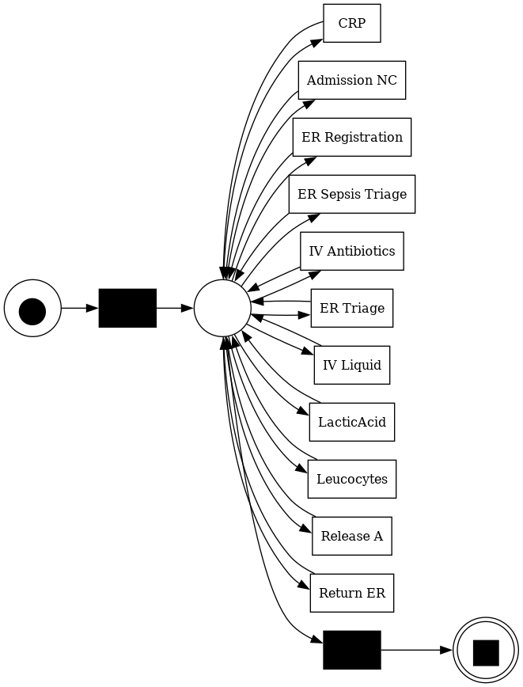
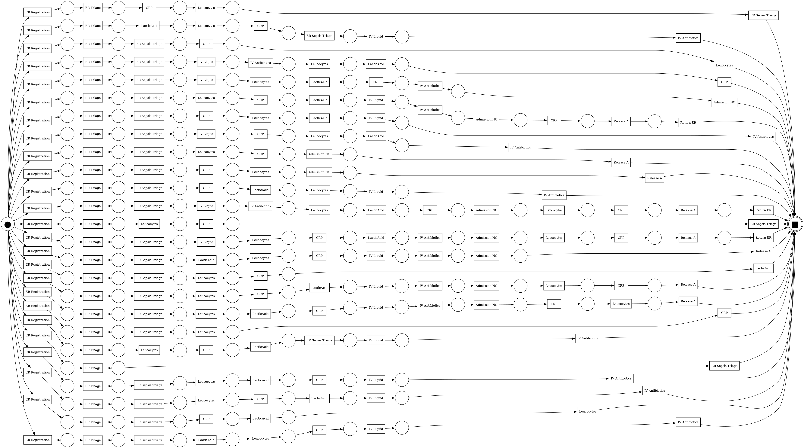
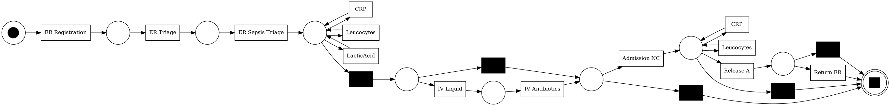

# Sepsis Process Mining with PM4Py

This project applies process mining to a hospital sepsis-treatment process using [PM4Py](https://pm4py.fit.fraunhofer.de/). Starting from the public **Sepsis Cases** event log, it builds a smaller log that satisfies the assignment constraints, analyzes it, discovers and compares Petri nets, and studies how noise filtering changes the interpretation of a rare trace.

The executable analysis and its latest outputs are in [`process_mining_sepsis_run.ipynb`](process_mining_sepsis_run.ipynb). The notebook was last executed on **20 November 2026** with Python 3.12.16 and PM4Py 2.7.23.13; all 17 code cells completed without errors. The sections below follow the seven tasks in the [assignment brief](assigment.txt).

## 1. Event log construction

The source is [`Sepsis Cases - Event Log.xes`](Sepsis%20Cases%20-%20Event%20Log.xes). Its 1,050 traces contain 846 variants, most of which occur only once, so models mined directly from it would be noisy and alignments slow.

The notebook keeps the **25 most frequent variants** with `pm4py.filter_variants_top_k`. The resulting log meets all three assignment requirements, and the notebook asserts each one:

| Requirement | Result |
| --- | --- |
| At least 20 variants | 25 variants |
| At least 100 traces | 190 traces |
| Non-uniform variant frequencies | Frequencies range from 35 to 3 |

| Log | Traces | Events | Variants | Activities |
| --- | ---: | ---: | ---: | ---: |
| Original Sepsis Cases log | 1,050 | 15,214 | 846 | 16 |
| Selected analysis log | 190 | 1,226 | 25 | 11 |

The selected variants, from most to least frequent, have frequencies:

```text
35, 24, 22, 13, 11, 9, 7, 5, 5, 5, 5, 4, 4, 4, 4, 4, 4, 4, 3, 3, 3, 3, 3, 3, 3
```

The full variant table is printed in the notebook. The filtering cell exports the selected log as `sepsis_log.xes`.

## 2. Statistical report

The notebook calculates the four required statistics directly from the selected log.

| Measure | Result |
| --- | ---: |
| Traces | 190 |
| Events | 1,226 |
| Average events per trace | 6.45 |
| Minimum events per trace | 3 |
| Maximum events per trace | 13 |

### Start activities

Every trace begins with the same activity.

| Activity | Count | Relative frequency |
| --- | ---: | ---: |
| `ER Registration` | 190 | 1.0000 |

### End activities

| Activity | Count | Relative frequency |
| --- | ---: | ---: |
| `IV Antibiotics` | 49 | 0.2579 |
| `ER Sepsis Triage` | 44 | 0.2316 |
| `CRP` | 27 | 0.1421 |
| `Leucocytes` | 26 | 0.1368 |
| `Release A` | 21 | 0.1105 |
| `LacticAcid` | 11 | 0.0579 |
| `Return ER` | 9 | 0.0474 |
| `Admission NC` | 3 | 0.0158 |

The selected log contains 11 activities: `Admission NC`, `CRP`, `ER Registration`, `ER Sepsis Triage`, `ER Triage`, `IV Antibiotics`, `IV Liquid`, `LacticAcid`, `Leucocytes`, `Release A`, and `Return ER`.

## 3. Hand-drawn Petri nets

The two hand-drawn models are in [`task 3.png`](task%203.png). The drawing can be edited in [Excalidraw](https://excalidraw.com/#json=UdAXlOm1TD1ZM523sgpKR,t_xllpRU_A1fS0mW1JzCXQ).

- The **high-precision net** models only observed sequences, with separate branches for distinct treatment paths.
- The **high-fitness net** uses a flower-like structure that permits almost any activity in almost any order.

<a href="task%203.png"></a>

Task 4 reconstructs the same two ideas in PM4Py so that they can be measured. The hand-drawn nets themselves are not evaluated programmatically.

## 4. Reference Petri nets: soundness and quality

Two reference models are built with PM4Py:

- **Flower model (high fitness):** any of the 11 activities may execute repeatedly, in any order.
- **Variant model (high precision):** an exclusive choice over one sequential branch per observed variant.

Both are checked with `pm4py.check_soundness` and evaluated against the selected log. PuLP was installed so that the soundness checks use a reliable solver.

| Model | Sound | Fitness | Precision | Generalization | Simplicity |
| --- | :---: | ---: | ---: | ---: | ---: |
| Flower (high fitness) | Yes | 1.0000 | 0.1797 | 0.8815 | 0.4444 |
| Variant model (high precision) | Yes | 1.0000 | 1.0000 | 0.0647 * | 0.8923 |

- Both nets replay the log perfectly, but for opposite reasons.
- The flower model permits almost arbitrary behavior, so precision is very low.
- The variant model allows only the 25 observed variants, so precision is perfect but generalization is very low: it rejects every unseen trace.
- The variant model's high simplicity score is misleading in context. PM4Py's degree-based measure does not penalize a large number of sequential branches.

The notebook renders the two reference nets as follows:

<p>
	<strong>Flower model (high fitness)</strong><br>
	<a href="reference_flower_net.png"></a>
</p>

<p>
	<strong>Variant model (high precision)</strong><br>
	<a href="reference_variant_net.png"></a>
</p>

\* The variant model's generalization is **not stable across runs**. Its branches reuse activity labels, and PM4Py's token-based replay may activate different transitions with the same label. The latest run gives 0.0647; earlier runs gave 0.0741 and 0.0773. The value remains close to zero relative to the flower and Inductive Miner models, so the qualitative conclusion is unchanged.

## 5. Inductive Miner with varying `noise_threshold`

The notebook mines four nets with `pm4py.discover_petri_net_inductive` using noise thresholds `0`, `0.2`, `0.7`, and `1`. All four are reported as sound.

| Noise threshold | Sound | Fitness | Precision | Generalization | Simplicity | Places | Transitions | Arcs |
| ---: | :---: | ---: | ---: | ---: | ---: | ---: | ---: | ---: |
| `0.0` | Yes | 1.0000 | 0.4649 | 0.8640 | 0.6316 | 23 | 25 | 62 |
| `0.2` | Yes | 0.9324 | 0.4948 | 0.8668 | 0.6508 | 20 | 21 | 52 |
| `0.7` | Yes | 0.7488 | 0.7102 | 0.8004 | 0.7561 | 15 | 16 | 36 |
| `1.0` | Yes | 0.5421 | 0.7285 | 0.6314 | 0.7500 | 10 | 14 | 28 |

As the threshold increases:

- **Fitness falls** from 1.00 to 0.54, because infrequent behavior is filtered out and some traces no longer fit.
- **Precision rises** from 0.46 to 0.73, mainly because the model becomes more restrictive by dropping variants.
- **Generalization** stays stable at `0` and `0.2`, then falls at `0.7` and `1`.
- **Simplicity** improves as the nets shrink, although it dips slightly from `0.7` to `1`.
- All four nets were checked and reported sound. The Inductive Miner produces block-structured models, which supports this result.

For this log, `noise = 0` maximizes fitness, while `0.2` offers a more balanced trade-off. `noise = 1` is compact but no longer represents much of the observed behavior.

## 6. Alignment of the least frequent variant

The least frequent variant appears three times:

```text
ER Registration -> ER Triage -> ER Sepsis Triage -> IV Liquid ->
IV Antibiotics -> Leucocytes -> LacticAcid -> CRP
```

The notebook computes an alignment against each of the four Inductive Miner models.

| Noise | Alignment cost | Trace fitness | Log-only moves | Model-only moves |
| ---: | ---: | ---: | --- | --- |
| `0.0` | 7 | 1.0000 | None | None |
| `0.2` | 5 | 1.0000 | None | None |
| `0.7` | 40,003 | 0.6000 | `Leucocytes`, `LacticAcid` | `Leucocytes`, `LacticAcid` |
| `1.0` | 70,000 | 0.4167 | `IV Liquid`, `IV Antibiotics`, `Leucocytes`, `LacticAcid`, `CRP` | `Release A`, `Return ER` |

PM4Py's default cost function charges 10,000 for a visible deviation and 1 for a silent routing move. The costs of 7 and 5 therefore indicate no visible anomaly.

The anomalies change in character as the threshold grows:

- At `0` and `0.2`, the rare trace is replayed exactly.
- At `0.7`, the model forces `LacticAcid` and `Leucocytes` before the IV treatment. This is an **ordering anomaly**.
- At `1.0`, five events cannot be replayed and the model requires activities the patient never performed. The trace is treated as noise and the model is too coarse.

## 7. LLM prompt and generated Petri net

[`llm_prompt.txt`](llm_prompt.txt) asks an LLM to act as a process-mining expert and build a sound workflow net for the sepsis process. It supplies:

- 190 traces, 1,226 events, 11 activities, and 25 variants;
- every variant with its frequency;
- directly-follows counts;
- start and end activity counts;
- a strict JSON schema with one source and one sink, labelled activity transitions, and silent transitions only for routing.

The rendered response is [`llm_petri_net.png`](llm_petri_net.png):

<a href="llm_petri_net.png"></a>

### Comparison with the Inductive Miner models

| Aspect | Inductive Miner (task 5) | LLM-generated net (task 7) |
| --- | --- | --- |
| Input | The complete selected event log | Aggregate statistics and examples in a prompt |
| Construction | Recursive block-structured process discovery | Generated from the prompt by a language model |
| Soundness | Checked for all four models | Not checked in this repository |
| Metrics | Fitness, precision, generalization, simplicity recorded | Not calculated |
| Reproducibility | Code and outputs are stored | Prompt and image are stored; the JSON response is missing |

The LLM net has a shared sequential backbone with routing choices for lab tests, IV treatment, admission, release, and return to the emergency room. The Inductive Miner models are derived algorithmically from the log and are block-structured by construction. Because the LLM's JSON response was not saved and the net was not rebuilt in PM4Py, the two approaches cannot be compared numerically here. Any comparison beyond structure would require saving the response, importing the net, checking soundness, and evaluating it on the same log.

## Reproducibility notes

- Latest execution: Python 3.12.16, PM4Py 2.7.23.13, NumPy 2.5.5, pandas 3.1.1, Graphviz 14.1.2, CBC 2.10.13, and PuLP 4.3.1.
- The notebook seeds Python's random module with `42`, but dependency versions are not pinned. PM4Py metric values may differ in another environment.
- The fresh run reproduced the stored trace, event, start/end, Inductive Miner, and alignment results. The only numerical difference was the variant model's generalization, discussed in task 4.
- Installing PuLP removed PM4Py's warning about unreliable scipy-based soundness checks. Without PuLP, the soundness results may be less reliable.
- The run still emits a deprecation warning for `pm4py.check_soundness`; a future PM4Py release may require updating that call.
- The LLM model can currently be compared only visually. Reproducible conformance checking requires its JSON response and a PM4Py reconstruction.

## Dataset citation

The bundled source log is the anonymized public dataset:

> Mannhardt, Felix (2016). *Sepsis Cases - Event Log*, Version 1. 4TU.ResearchData. <https://doi.org/10.4121/uuid:915d2bfb-7e84-49ad-a286-dc35f063a460>

The dataset description states that event attributes are anonymized and timestamps are randomized while preserving the time differences within each trace. Refer to the dataset page for its terms of use.
